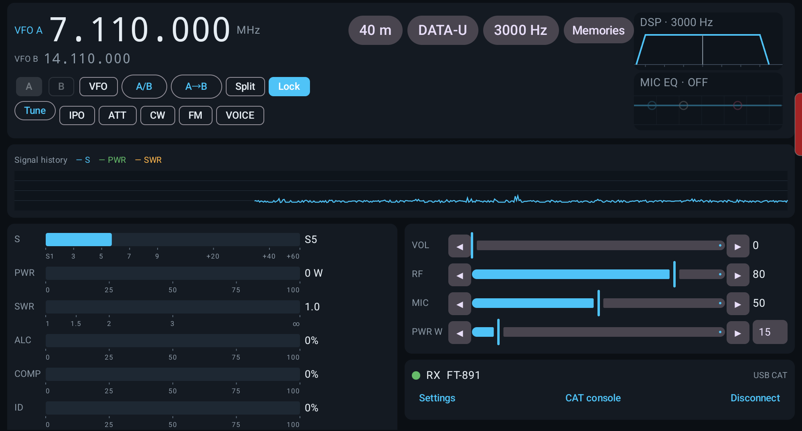

# Cat Explorer

A touchscreen controller for the **Yaesu FT-891** HF transceiver, for Android tablets and phones. It shows the radio's frequency, mode, filter and meters live and lets you control the radio from the screen, either **through FLRig on a PC** or **directly over USB** with an OTG cable and no PC at all. Inspired by the creater of the CatTouch7USB, Chris Day Zl1CVD.  Use the hardware you already have lying around and put it to good use!



**New to the app? Read the [User Guide (PDF)](docs/Cat-Explorer-User-Guide.pdf).** It covers connecting to the radio, every screen and button, and all of the settings, with screenshots.

> **Radio support: FT-891 only, for now.**
> Most of the CAT (Computer Aided Transceiver) commands in this app are written for the FT-891 and its CAT manual: the DSP and filter settings, meter scales, memory channels, filter-width table and the like. Other Yaesu radios use different commands and ranges, and other brands use different protocols altogether. The app has only been tested on an FT-891. Support for other radios may come but I am limited to the radios that I have to test.

## What it does

- **Live readout and control**: frequency (tap to type one in), VFO A/B, split, mode, band, filter width, IPO/ATT and dial lock.
- **Meters**: S, power, SWR, ALC, compression and drain current, as bars or analogue needle gauges, plus a rolling signal-history trace.
- **Sliders**: volume, RF gain, mic gain and TX power, with ◀ ▶ arrows for single steps.
- **DSP and IF popup** (tap the DSP graph): IF shift, width, noise blanker and reduction, contour, notch, APF and AGC. A mic EQ and speech-processor popup is available from the MIC EQ graph.
- **CW, FM and voice-memory panels** for keyer speed, pitch and break-in, repeater shift and tones, and voice-memory playback.
- **Memory channels**: a table of the radio's programmed channels. Tap a row to go to it, or add and edit channels (frequency, mode, tone, shift, name). The channel list is backed up to the app's files folder before the first write of a session.
- **Band button**: jumps to a phone calling frequency on each band and sets its usual mode (30 m goes to its digital frequency in DATA-U). The Bands tab lists the digital-mode calling frequencies.
- **Tune button**: runs the radio's own antenna tuner, or, for an external auto-tuner, sends a short low-power AM carrier and then puts your mode, width and power back.
- **Raw CAT console** for sending any CAT command and seeing the reply.
- **Themes**: dark or light, with every colour changeable.

## Two ways to connect

### Directly over USB (no PC)

Plug the radio's USB port into the tablet with a USB-C OTG cable. In the app, enter the baud rate and tap **Connect over USB**. The baud rate must match the radio's CAT RATE (menu 05-06). Android will ask once for permission to use the radio's USB serial bridge.

- The app speaks CAT straight to the radio. FLRig and the PC are not involved.
- The radio can only be connected to one computer at a time, so with the tablet plugged in the PC cannot use the same USB port (a USB hub does not change this).
- Some things are not available in this mode: typed CW text (use the keyer memories 1 to 5), FLRig's user buttons, and the A and B VFO buttons (the radio has no CAT command to pick a VFO; use A/B to swap them instead).

### Through FLRig on a PC

Run FLRig on the computer the radio is plugged into. In FLRig turn on the XML-RPC server (Config → Setup → UI → Server), make sure it listens on the network and not only on localhost, and allow its port (default 12345) through the PC's firewall. In the app, enter the PC's address and port and tap **Connect**. The tablet and the PC must be on the same network or VPN.

### Waterfall (FLRig connection only)

The radio screen has a **Waterfall** card that shows the radio's receive audio, about 0 to 4 kHz: everything inside your current filter. Tap a signal to tune to it. In CW the signal goes onto your CW pitch, in DATA it goes to 1500 Hz, and in SSB the point you tap becomes the carrier (tap the low edge of a USB voice signal). **Listen** also plays the audio on the tablet.

The FT-891 has no wide band-scope output, so this is a passband waterfall, not a wide panadapter. The audio comes from a small program on the FLRig PC, **Cat Explorer Panadapter**, that records the sound card wired to the radio's DATA jack.

**The easy way: install the Panadapter window.** From the Cat Explorer folder run

```bash
pc-panadapter/install.sh
```

That installs it just for you (no password). Run it with `sudo` instead to install it for every user on the PC, and with `--uninstall` to remove it. It adds **Cat Explorer Panadapter**, with the app's icon, to the **Ham Radio** folder of the start menu (creating that folder if your system doesn't have one), plus a `cat-panadapter` command. It needs Python 3, GTK 3 for Python (`python3-gi`) and `pulseaudio-utils`, which Mint, Ubuntu and Pop!_OS include; if one is missing, the installer tells you the `apt` command to get it.

Open it from the menu, pick the sound card from **Sound input** and press **Start**. The window shows whether the panadapter is running, the PC's addresses, which tablets are connected, and a live audio level that warns you if the audio is clipping. You can close the window: the panadapter keeps running in the background until you open the window again and press **Stop**. (Without installing, `python3 pc-panadapter/cat-panadapter.py` opens the same window.)

The desktop icon is made from the app's own launcher icon by `pc-panadapter/icon/make-icons.py`; run it again if the app icon changes.

**From a terminal** (no window):

```bash
python3 pc-panadapter/cat-panadapter-server.py --list     # show the sound inputs
python3 pc-panadapter/cat-panadapter-server.py            # picks the USB sound card by itself; or add --device NAME
```

The panadapter needs only Python 3 and `parec` (PulseAudio/PipeWire) or `arecord`. It listens on port 7366 (change it in the window or with `--port`, and in the app's Settings). It has no password, so keep it on your home network or VPN like FLRig's port. If the app or the window says the audio is too loud, turn the sound card's input level down on the PC. The waterfall is off in USB mode because the tablet can't get the radio's audio over the USB cable.

#### RTL-SDR: a real wide panadapter

With an RTL-SDR on the FLRig PC, the Waterfall tab becomes a true panadapter: about 200 kHz of the band around your dial, with real frequencies, a red line at the dial, your receive filter shaded, **Span** from 200 kHz down to 10 kHz, and tap-to-tune (CW and DATA taps snap to the nearest signal; DATA puts the signal at 1500 Hz in your audio). The PC reads the radio's frequency from FLRig, keeps the SDR tuned near it (retuning by itself when you change band), does the FFT and sends the picture to the tablet. It pauses while you transmit.

**Protect the SDR.** It needs its own receive antenna or a T/R switch keyed by the radio (for example from the FT-891's TX GND line on the rear LINEAR jack). Never connect it to the radio's antenna: one transmission would destroy it. With a separate antenna near your HF antenna, add an RF limiter and keep the power down until you know what it picks up.

Setup, once:

1. Install the tools and numpy: `sudo apt install rtl-sdr python3-numpy`, then unplug and replug the dongle.
2. Build RTL-SDR Blog's driver into your home folder. Ubuntu's `rtl-sdr` 2.0.1 returns no data in the direct-sampling mode a V3 uses for HF; RTL-SDR Blog's version works and switches to it by itself below 24 MHz:

   ```bash
   git clone https://github.com/rtlsdrblog/rtl-sdr-blog ~/.local/src/rtl-sdr-blog
   cd ~/.local/src/rtl-sdr-blog && mkdir -p build && cd build
   cmake .. -DCMAKE_INSTALL_PREFIX=$HOME/.local/opt/rtl-sdr-blog -DINSTALL_UDEV_RULES=OFF -DDETACH_KERNEL_DRIVER=ON
   make -j4 && make install
   ```

3. In the Panadapter window choose **RTL-SDR — wide panadapter** as the source and press Start. **SDR gain** only matters above 24 MHz (10 m, 6 m); lower it if the window says the SDR is overloaded. **Correction** (ppm) fixes an SDR that shows signals off their real frequency. **Test on a fixed frequency** points it at, say, FM broadcast (98.0) to check it works without FLRig; taps do nothing then.

Below 24 MHz a V3 has no amplifier in front, so it needs a decent wire (5–10 m or more); a small whip shows little but interference there. On 10 m and 6 m it uses its normal tuner and a small antenna does much better.

#### Band edges and colours

Both waterfalls mark the US (FCC) amateur band plan: band edges as solid white lines with everything outside the band dimmed, and sub-band edges as dashed lines, each labelled with its frequency. A strip under the spectrum has one row per license class (**E**xtra, **A**dvanced, **G**eneral, **T**echnician), coloured where that class may transmit: yellow = CW only, blue = CW & data, green = phone & CW, purple = all modes; blank means no privileges. It covers 160 m to 6 m plus 2 m and 70 cm (60 m as its five channels). It is a guide: check the current FCC rules before relying on it. Turn it off under **Settings → Waterfall → Band edges (US)**. The audio waterfall shows edges only in SSB, CW and DATA modes, where audio maps simply to RF.

**Settings → Waterfall → Colours** picks the waterfall's colour theme: the app's own **Cat Explorer** colours, or any of the 28 palettes that come with JS8Call (the same set WSJT-X has). Changing it recolours the whole picture at once, including what has already scrolled by.

## Safety

This app can **transmit**. The Tune button, the CW keyer memories and voice-message playback key the radio. Check that your antenna is connected and use low power when trying new things. The Tune carrier is limited to 5 to 10 W and stops by itself after one minute.

## Build

You need JDK 17 and the Android SDK. `env.sh` shows the paths used here (adjust them for your machine).

```bash
source ./env.sh                 # JDK 17 + Gradle + Android SDK paths
./gradlew :app:assembleDebug    # -> app/build/outputs/apk/debug/app-debug.apk
./gradlew :app:testDebugUnitTest
adb install -r app/build/outputs/apk/debug/app-debug.apk
```

`CATEXPLORER_LIVE=127.0.0.1 ./gradlew :app:testDebugUnitTest` adds a read-only test against a running FLRig.

## Code layout

- `rig/RigClient.kt`: the interface both connections implement.
- `rig/FlrigClient.kt` and `rig/XmlRpc.kt`: the FLRig connection (a small XML-RPC client).
- `rig/UsbCatClient.kt` and `rig/UsbLink.kt`: the direct USB connection (CAT over the radio's CP2105 serial bridge, using the [usb-serial-for-android](https://github.com/mik3y/usb-serial-for-android) library).
- `rig/YaesuDsp.kt`: FT-891 CAT command strings and reply parsers.
- `audio/`: the waterfall: `AudioLink.kt` (the stream from the PC Panadapter: audio with Listen playback, or SDR spectrum lines) and `Waterfall.kt` (FFT, waterfall rows, the SDR view's `WideEngine`, tap-to-tune maths).
- `pc-panadapter/cat-panadapter-server.py`: the PC side of the waterfall; `pc-panadapter/cat-panadapter.py` is its window.
- `RigViewModel.kt`: the polling loop and command dispatch.
- `ui/`: connect screen, radio screen, meters, DSP and memory panels, settings.

## Status and limits

- Tested on an FT-891 with a Samsung Galaxy Tab S6 Lite (Android 16). The FLRig path has had the most use. The USB path is newer: reading the radio, width changes, the A/B swap, Tune and the Band button have been tested over USB, while other controls have had less testing there.
- The radio's spectrum scope can't be shown because the FT-891 doesn't send scope data over CAT. The waterfall shows only the receive passband (see above).
- The radio can't store a filter width in a memory channel over CAT.
- Meter scales (especially SWR and S) are approximations.

## License

Cat Explorer is open source under the [MIT License](LICENSE). Copyright (c) 2026 David Kane (W6MZT).
